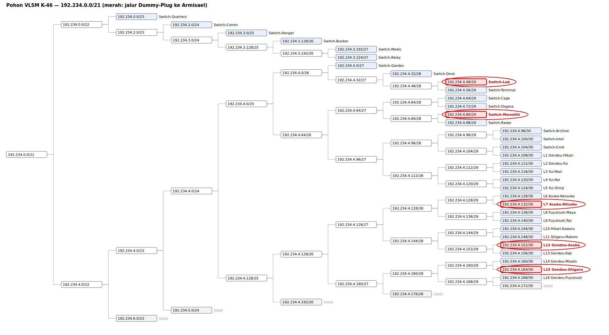

# Jarkom Modul 5 K-46

| 	Nama              	| NRP        | Pembagian Pengerjaaan  |
| ---------------------	| ---------- | ---------------------- |
| Hendra Manudinata 	| 5027251051 | -                      |
| Daffa Rifqi As Shidiq	| 5027251038 | -                      |

* Kelompok: K-46
* Prefix IP: 192.234.x.x
* Project GNS3: `K-46-MODUL-5`

Struktur repository:

* `subnetting/` berisi tabel VLSM (`vlsm.md`, `vlsm.csv`), IP tiap node (`ip-node.csv`), dan pohon IP (`pohon-ip.png`, `pohon-ip.svg`).
* `perquest-scripts/soal_N/<node>.sh` berisi script tiap soal. Script dikirim ke node sebagai `/root/soal_N.sh` lalu dijalankan.

---

## Soal 1
**Markas tanpa peta:** tengah malam alarm meraung, dan Ritsuko terdiam. Markas sebesar ini dibangun tanpa peta alamat. Gendo anti pemborosan, jadi tiap subnet memakai **prefix terkecil yang muat**. Bagi prefix IP kelompokmu dengan **VLSM** untuk **17 LAN dan 16 link antar-router**, urut dari kebutuhan terbesar. Tunjukkan **tabel** berisi network, prefix, gateway, broadcast, IP terpakai, dan sisa. Tunjukkan juga **gambar pohon IP**, dengan subnet jalur **Dummy-Plug ke Armisael dilingkari**. Di laporan, jelaskan hitungan satu subnet.

### Jawaban dan Penjelasan

#### 1. Aturan Pembagian

* Kebutuhan alamat tiap LAN = jumlah host + 1 (gateway). Link antar-router selalu butuh 2 alamat.
* Prefix dipilih yang terkecil dengan jumlah usable `2^(32 - prefix) - 2` yang masih muat.
* Subnet diurutkan dari blok terbesar. Jika ukurannya sama, LAN didahulukan daripada link, lalu mengikuti urutan tabel.
* Gateway memakai IP usable pertama. Node pada switch memakai IP berikutnya sesuai urutan nama di gambar (kiri ke kanan).
* Pada link, IP pertama untuk router atas (arah Gendou) dan IP kedua untuk router bawah.
* Urutan link disusun agar subnet satu cabang bisa diringkas tepat menjadi satu CIDR pada soal 3.

#### 2. Tabel VLSM

<details>
<summary>Tabel VLSM (33 subnet: 17 LAN + 16 link)</summary>

| No | Subnet | Kebutuhan | Prefix | Network | Gateway | Broadcast | Usable | Terpakai | Sisa |
|---|---|---|---|---|---|---|---|---|---|
| 1 | Switch-Quarters | 501 | /23 | 192.234.0.0 | 192.234.0.1 | 192.234.1.255 | 510 | 501 | 9 |
| 2 | Switch-Comm | 201 | /24 | 192.234.2.0 | 192.234.2.1 | 192.234.2.255 | 254 | 201 | 53 |
| 3 | Switch-Hangar | 101 | /25 | 192.234.3.0 | 192.234.3.1 | 192.234.3.127 | 126 | 101 | 25 |
| 4 | Switch-Bunker | 56 | /26 | 192.234.3.128 | 192.234.3.129 | 192.234.3.191 | 62 | 56 | 6 |
| 5 | Switch-Medic | 27 | /27 | 192.234.3.192 | 192.234.3.193 | 192.234.3.223 | 30 | 27 | 3 |
| 6 | Switch-Relay | 26 | /27 | 192.234.3.224 | 192.234.3.225 | 192.234.3.255 | 30 | 26 | 4 |
| 7 | Switch-Garden | 15 | /27 | 192.234.4.0 | 192.234.4.1 | 192.234.4.31 | 30 | 15 | 15 |
| 8 | Switch-Dock | 13 | /28 | 192.234.4.32 | 192.234.4.33 | 192.234.4.47 | 14 | 13 | 1 |
| 9 | Switch-Lab | 6 | /29 | 192.234.4.48 | 192.234.4.49 | 192.234.4.55 | 6 | 6 | 0 |
| 10 | Switch-Terminal | 4 | /29 | 192.234.4.56 | 192.234.4.57 | 192.234.4.63 | 6 | 4 | 2 |
| 11 | Switch-Cage | 4 | /29 | 192.234.4.64 | 192.234.4.65 | 192.234.4.71 | 6 | 4 | 2 |
| 12 | Switch-Dogma | 3 | /29 | 192.234.4.72 | 192.234.4.73 | 192.234.4.79 | 6 | 3 | 3 |
| 13 | Switch-Monolith | 3 | /29 | 192.234.4.80 | 192.234.4.81 | 192.234.4.87 | 6 | 3 | 3 |
| 14 | Switch-Radar | 5 | /29 | 192.234.4.88 | 192.234.4.89 | 192.234.4.95 | 6 | 5 | 1 |
| 15 | Switch-Archive | 2 | /30 | 192.234.4.96 | 192.234.4.97 | 192.234.4.99 | 2 | 2 | 0 |
| 16 | Switch-Intel | 2 | /30 | 192.234.4.100 | 192.234.4.101 | 192.234.4.103 | 2 | 2 | 0 |
| 17 | Switch-Cmd | 2 | /30 | 192.234.4.104 | 192.234.4.105 | 192.234.4.107 | 2 | 2 | 0 |
| 18 | L1 Gendou-Hikari | 2 | /30 | 192.234.4.108 | 192.234.4.109 | 192.234.4.111 | 2 | 2 | 0 |
| 19 | L2 Gendou-Yui | 2 | /30 | 192.234.4.112 | 192.234.4.113 | 192.234.4.115 | 2 | 2 | 0 |
| 20 | L3 Yui-Mari | 2 | /30 | 192.234.4.116 | 192.234.4.117 | 192.234.4.119 | 2 | 2 | 0 |
| 21 | L4 Yui-Rei | 2 | /30 | 192.234.4.120 | 192.234.4.121 | 192.234.4.123 | 2 | 2 | 0 |
| 22 | L5 Yui-Shinji | 2 | /30 | 192.234.4.124 | 192.234.4.125 | 192.234.4.127 | 2 | 2 | 0 |
| 23 | L6 Asuka-Kensuke | 2 | /30 | 192.234.4.128 | 192.234.4.129 | 192.234.4.131 | 2 | 2 | 0 |
| 24 | L7 Asuka-Ritsuko | 2 | /30 | 192.234.4.132 | 192.234.4.133 | 192.234.4.135 | 2 | 2 | 0 |
| 25 | L8 Fuyutsuki-Maya | 2 | /30 | 192.234.4.136 | 192.234.4.137 | 192.234.4.139 | 2 | 2 | 0 |
| 26 | L9 Fuyutsuki-Toji | 2 | /30 | 192.234.4.140 | 192.234.4.141 | 192.234.4.143 | 2 | 2 | 0 |
| 27 | L10 Hikari-Kaworu | 2 | /30 | 192.234.4.144 | 192.234.4.145 | 192.234.4.147 | 2 | 2 | 0 |
| 28 | L11 Shigeru-Makoto | 2 | /30 | 192.234.4.148 | 192.234.4.149 | 192.234.4.151 | 2 | 2 | 0 |
| 29 | L12 Gendou-Asuka | 2 | /30 | 192.234.4.152 | 192.234.4.153 | 192.234.4.155 | 2 | 2 | 0 |
| 30 | L13 Gendou-Kaji | 2 | /30 | 192.234.4.156 | 192.234.4.157 | 192.234.4.159 | 2 | 2 | 0 |
| 31 | L14 Gendou-Misato | 2 | /30 | 192.234.4.160 | 192.234.4.161 | 192.234.4.163 | 2 | 2 | 0 |
| 32 | L15 Gendou-Shigeru | 2 | /30 | 192.234.4.164 | 192.234.4.165 | 192.234.4.167 | 2 | 2 | 0 |
| 33 | L16 Gendou-Fuyutsuki | 2 | /30 | 192.234.4.168 | 192.234.4.169 | 192.234.4.171 | 2 | 2 | 0 |

</details>

Total alokasi adalah `192.234.0.0` sampai `192.234.4.171`. Tabel lengkap dengan netmask dan range ada di [`subnetting/vlsm.md`](subnetting/vlsm.md), sedangkan IP tiap node ada di [`subnetting/ip-node.csv`](subnetting/ip-node.csv).

#### 3. Hitungan Satu Subnet: Switch-Garden

1. Kebutuhan: Garden-Staff 14 host + 1 gateway (Shinji) = **15 alamat**.
2. Prefix /28 memberi `2^4 - 2 = 14` usable, sehingga **tidak muat**. Prefix /27 memberi `2^5 - 2 = 30` usable, sehingga dipakai **/27** (netmask `255.255.255.224`).
3. Subnet sebelumnya (Switch-Relay `192.234.3.224/27`) berakhir di `192.234.3.255`, sehingga Switch-Garden dimulai di `192.234.4.0`.
4. Blok /27 berisi 32 alamat, yaitu `192.234.4.0` sampai `192.234.4.31`:
   * Network: `192.234.4.0`
   * Gateway (Shinji): `192.234.4.1`
   * Garden-Staff: `192.234.4.2`
   * Broadcast: `192.234.4.31`
5. Terpakai 15 dari 30 usable, sehingga sisa 15.

#### 4. Pohon IP

Subnet pada jalur Dummy-Plug ke Armisael dilingkari merah: Switch-Lab (`192.234.4.48/29`), L7 Asuka-Ritsuko (`192.234.4.132/30`), L12 Gendou-Asuka (`192.234.4.152/30`), L15 Gendou-Shigeru (`192.234.4.164/30`), dan Switch-Monolith (`192.234.4.80/29`).




## Soal 2
**Geofront gelap gulita:** kabel sudah ditarik, tapi saat Misato menekan tombol daya, Geofront tetap gelap. Tidak ada alamat dan tidak ada rute. Pasang semua node di GNS3 sesuai topologi. Beri IP ke tiap interface router sesuai soal 1, lalu aktifkan **IP forwarding** di semua router. Hanya **Gendou** yang terhubung ke NAT1 dan mendapat alamat lewat **DHCP**. Router lain baru bisa memasang paket setelah soal 4, karena internet baru ada saat itu. Tunjukkan `ip -br` di tiap router dan ping dua ujung tiap link router ke router.

### Jawaban dan Penjelasan

#### 1. Topologi GNS3

Topologi berisi 17 router, 17 switch, 25 host, dan NAT1 dengan total 59 link. Semua router dan host memakai image `ardhptr21/alpinet:latest`, kecuali Magi-Casper, Magi-Balthasar, dan Magi-Melchior yang memakai `ardhptr21/debinet:latest` karena soal 7 membutuhkan paket `netcat-traditional`.

Pemetaan interface pada setiap router dibuat seragam:

* `eth0` selalu menuju router di atasnya (Gendou menuju NAT1).
* `eth1` selalu menuju switch LAN milik router tersebut.
* `eth2` dan seterusnya menuju router di bawahnya.

<details>
<summary>Pemetaan interface 17 router</summary>

| Router | eth0 | eth1 | eth2 | eth3 | eth4 | eth5–eth8 |
|---|---|---|---|---|---|---|
| Gendou | NAT1 (DHCP) | Switch-Cmd `.4.105/30` | Yui `.4.113/30` | Hikari `.4.109/30` | Asuka `.4.153/30` | Kaji `.4.157`, Misato `.4.161`, Shigeru `.4.165`, Fuyutsuki `.4.169` (/30) |
| Yui | Gendou `.4.114/30` | Switch-Hangar `.3.1/25` | Mari `.4.117/30` | Rei `.4.121/30` | Shinji `.4.125/30` | |
| Mari | Yui `.4.118/30` | Switch-Dock `.4.33/28` | | | | |
| Rei | Yui `.4.122/30` | Switch-Quarters `.0.1/23` | | | | |
| Shinji | Yui `.4.126/30` | Switch-Garden `.4.1/27` | | | | |
| Hikari | Gendou `.4.110/30` | Switch-Comm `.2.1/24` | Kaworu `.4.145/30` | | | |
| Kaworu | Hikari `.4.146/30` | Switch-Relay `.3.225/27` | | | | |
| Asuka | Gendou `.4.154/30` | Switch-Archive `.4.97/30` | Kensuke `.4.129/30` | Ritsuko `.4.133/30` | | |
| Kensuke | Asuka `.4.130/30` | Switch-Bunker `.3.129/26` | | | | |
| Ritsuko | Asuka `.4.134/30` | Switch-Lab `.4.49/29` | | | | |
| Kaji | Gendou `.4.158/30` | Switch-Intel `.4.101/30` | | | | |
| Misato | Gendou `.4.162/30` | Switch-Cage `.4.65/29` | | | | |
| Shigeru | Gendou `.4.166/30` | Switch-Monolith `.4.81/29` | Makoto `.4.149/30` | | | |
| Makoto | Shigeru `.4.150/30` | Switch-Radar `.4.89/29` | | | | |
| Fuyutsuki | Gendou `.4.170/30` | Switch-Terminal `.4.57/29` | Maya `.4.137/30` | Toji `.4.141/30` | | |
| Maya | Fuyutsuki `.4.138/30` | Switch-Medic `.3.193/27` | | | | |
| Toji | Fuyutsuki `.4.142/30` | Switch-Dogma `.4.73/29` | | | | |

Semua alamat di atas berawalan `192.234.`.

</details>

#### 2. Konfigurasi `Gendou`

Gendou adalah satu-satunya router yang terhubung ke NAT1, sehingga `eth0` memakai DHCP. Interface lainnya diberi IP statis sesuai tabel VLSM.

```bash
auto eth0
iface eth0 inet dhcp
    up sysctl -w net.ipv4.ip_forward=1

# Switch-Cmd
auto eth1
iface eth1 inet static
    address 192.234.4.105
    netmask 255.255.255.252

# L2 ke Yui
auto eth2
iface eth2 inet static
    address 192.234.4.113
    netmask 255.255.255.252

# ... eth3 sampai eth8 mengikuti pola yang sama
```

Konfigurasi ditulis ke `/etc/network/interfaces`, yang diterapkan ulang oleh GNS3 setiap kali node dinyalakan, sehingga IP bertahan setelah restart. Baris `up sysctl -w net.ipv4.ip_forward=1` memastikan IP forwarding aktif setiap kali interface naik. Agar langsung berlaku tanpa restart, script juga menerapkan konfigurasi saat itu juga:

```bash
ip link set eth0 up
udhcpc -i eth0 -n -q
ip addr flush dev eth1; ip addr add 192.234.4.105/30 dev eth1; ip link set eth1 up
# ... dan seterusnya untuk eth2 sampai eth8
sysctl -w net.ipv4.ip_forward=1
```

#### 3. Konfigurasi Router Lain

Router lain memakai pola yang sama, hanya saja semua interface statis. Sebagai contoh, konfigurasi `Asuka`:

```bash
# L12 ke Gendou
auto eth0
iface eth0 inet static
    address 192.234.4.154
    netmask 255.255.255.252
    up sysctl -w net.ipv4.ip_forward=1

# Switch-Archive
auto eth1
iface eth1 inet static
    address 192.234.4.97
    netmask 255.255.255.252

# L6 ke Kensuke
auto eth2
iface eth2 inet static
    address 192.234.4.129
    netmask 255.255.255.252

# L7 ke Ritsuko
auto eth3
iface eth3 inet static
    address 192.234.4.133
    netmask 255.255.255.252
```

Script lengkap tiap router ada di `perquest-scripts/soal_2/<router>.sh` dan dijalankan di node sebagai `/root/soal_2.sh`. Pada soal ini belum ada rute antar-subnet, sehingga yang bisa saling ping hanya dua ujung link yang terhubung langsung. Rute dibuat pada soal 3.

### Verifikasi

#### 1. Verifikasi `Gendou`

```bash
ip -4 -br addr
ping -c 2 192.168.122.1      # NAT1
ping -c 2 192.234.4.114      # Yui (dan seterusnya untuk 7 link lainnya)
```

```
lo               UNKNOWN        127.0.0.1/8
eth0             UNKNOWN        192.168.122.172/24
eth1             UNKNOWN        192.234.4.105/30
eth2             UNKNOWN        192.234.4.113/30
eth3             UNKNOWN        192.234.4.109/30
eth4             UNKNOWN        192.234.4.153/30
eth5             UNKNOWN        192.234.4.157/30
eth6             UNKNOWN        192.234.4.161/30
eth7             UNKNOWN        192.234.4.165/30
eth8             UNKNOWN        192.234.4.169/30
```

`eth0` mendapat `192.168.122.172/24` dari DHCP NAT1, dan `eth1` sampai `eth8` sudah memiliki IP sesuai tabel. Ping ke NAT1 dan ke tujuh router tetangga (Yui, Hikari, Asuka, Kaji, Misato, Shigeru, Fuyutsuki) menghasilkan 0% packet loss.

#### 2. Verifikasi Link Router ke Router

Ping dijalankan dari kedua ujung setiap link. Seluruh 16 link berhasil dengan 0% packet loss:

<details>
<summary>Hasil ping 16 link router ke router</summary>

| Link | Ujung atas | Ujung bawah | Hasil |
|---|---|---|---|
| L1 Gendou-Hikari | 192.234.4.109 | 192.234.4.110 | 0% loss dua arah |
| L2 Gendou-Yui | 192.234.4.113 | 192.234.4.114 | 0% loss dua arah |
| L3 Yui-Mari | 192.234.4.117 | 192.234.4.118 | 0% loss dua arah |
| L4 Yui-Rei | 192.234.4.121 | 192.234.4.122 | 0% loss dua arah |
| L5 Yui-Shinji | 192.234.4.125 | 192.234.4.126 | 0% loss dua arah |
| L6 Asuka-Kensuke | 192.234.4.129 | 192.234.4.130 | 0% loss dua arah |
| L7 Asuka-Ritsuko | 192.234.4.133 | 192.234.4.134 | 0% loss dua arah |
| L8 Fuyutsuki-Maya | 192.234.4.137 | 192.234.4.138 | 0% loss dua arah |
| L9 Fuyutsuki-Toji | 192.234.4.141 | 192.234.4.142 | 0% loss dua arah |
| L10 Hikari-Kaworu | 192.234.4.145 | 192.234.4.146 | 0% loss dua arah |
| L11 Shigeru-Makoto | 192.234.4.149 | 192.234.4.150 | 0% loss dua arah |
| L12 Gendou-Asuka | 192.234.4.153 | 192.234.4.154 | 0% loss dua arah |
| L13 Gendou-Kaji | 192.234.4.157 | 192.234.4.158 | 0% loss dua arah |
| L14 Gendou-Misato | 192.234.4.161 | 192.234.4.162 | 0% loss dua arah |
| L15 Gendou-Shigeru | 192.234.4.165 | 192.234.4.166 | 0% loss dua arah |
| L16 Gendou-Fuyutsuki | 192.234.4.169 | 192.234.4.170 | 0% loss dua arah |

</details>

<!-- TODO: tambahkan screenshot ip -br dan ping dari GNS3 -->


## Soal 3
**Pulau-pulau yang terpisah:** lampu mulai menyala, tapi tiap segmen masih seperti pulau terpisah. Fuyutsuki mengingatkan: bangun jalur dari Gendo ke bawah, cabang demi cabang. Hubungkan semua subnet dengan **routing statis** dan **jumlah rute sesedikit mungkin**. Router selain Gendo cukup punya satu **default route ke atas** dan rute untuk subnet di bawahnya. Gendo memakai default route ke NAT1. Subnet satu cabang yang bisa digabung tepat menjadi satu CIDR **harus diringkas**. Untuk soal 3 sampai 5, beri IP dan gateway **sementara** pada node uji. IP permanen dibuat di soal 6. Buktikan **Armisael bisa ping ke Lilith, Sachiel, dan Comm-Net**.

### Jawaban dan Penjelasan

#### 1. Prinsip Routing

* **Router daun** (Mari, Rei, Shinji, Kaworu, Kensuke, Ritsuko, Kaji, Misato, Makoto, Maya, Toji) hanya memiliki LAN sendiri, sehingga cukup satu default route ke router di atasnya.
* **Router cabang** (Yui, Hikari, Asuka, Shigeru, Fuyutsuki) memiliki default route ke Gendou, ditambah satu rute untuk setiap LAN milik router di bawahnya. Link ke router bawah sudah terhubung langsung, sehingga tidak perlu rute.
* **Gendou** memakai default route ke NAT1 yang didapat dari DHCP, ditambah rute ke setiap subnet di tiap cabang yang tidak terhubung langsung.
* **Peringkasan**: subnet satu cabang yang bersebelahan dan tepat membentuk satu blok CIDR digabung menjadi satu rute. Urutan link pada soal 1 sengaja disusun agar hal ini bisa dilakukan:

| Rute ringkasan | Isi | Via |
|---|---|---|
| `192.234.4.112/28` | L2 Gendou-Yui, L3 Yui-Mari, L4 Yui-Rei, L5 Yui-Shinji | Yui |
| `192.234.4.128/29` | L6 Asuka-Kensuke, L7 Asuka-Ritsuko | Asuka |
| `192.234.4.136/29` | L8 Fuyutsuki-Maya, L9 Fuyutsuki-Toji | Fuyutsuki |
| `192.234.4.80/28` | Switch-Monolith (`.80/29`), Switch-Radar (`.88/29`) | Shigeru |

Subnet lain tidak bisa diringkas tepat. Contohnya, Garden (`4.0/27`) dan Dock (`4.32/28`) sama-sama di cabang Yui, tetapi blok gabungannya `4.0/26` ikut memuat Lab (`4.48/29`) milik cabang Asuka.

Rute ditulis sebagai baris `up ip route replace ...` di `/etc/network/interfaces`, di bawah interface yang menjadi jalan keluar ke next hop. Dengan begitu rute dipasang setiap kali interface naik dan bertahan setelah restart. Script juga langsung menerapkan rute dengan `ip route replace`, yang aman dijalankan berulang tanpa membuat rute dobel.

#### 2. Konfigurasi `Gendou`

Gendou memiliki 20 rute statis, ditambah default route dari DHCP NAT1:

<details>
<summary>20 rute statis Gendou</summary>

```bash
# Cabang Yui (5 rute)
ip route replace 192.234.0.0/23   via 192.234.4.114   # Quarters
ip route replace 192.234.3.0/25   via 192.234.4.114   # Hangar
ip route replace 192.234.4.0/27   via 192.234.4.114   # Garden
ip route replace 192.234.4.32/28  via 192.234.4.114   # Dock
ip route replace 192.234.4.112/28 via 192.234.4.114   # L2-L5 (ringkasan)

# Cabang Hikari (3 rute)
ip route replace 192.234.2.0/24   via 192.234.4.110   # Comm
ip route replace 192.234.3.224/27 via 192.234.4.110   # Relay
ip route replace 192.234.4.144/30 via 192.234.4.110   # L10 Hikari-Kaworu

# Cabang Asuka (4 rute)
ip route replace 192.234.4.96/30  via 192.234.4.154   # Archive
ip route replace 192.234.3.128/26 via 192.234.4.154   # Bunker
ip route replace 192.234.4.48/29  via 192.234.4.154   # Lab
ip route replace 192.234.4.128/29 via 192.234.4.154   # L6-L7 (ringkasan)

# Kaji dan Misato (1 rute masing-masing)
ip route replace 192.234.4.100/30 via 192.234.4.158   # Intel
ip route replace 192.234.4.64/29  via 192.234.4.162   # Cage

# Cabang Shigeru (2 rute)
ip route replace 192.234.4.80/28  via 192.234.4.166   # Monolith + Radar (ringkasan)
ip route replace 192.234.4.148/30 via 192.234.4.166   # L11 Shigeru-Makoto

# Cabang Fuyutsuki (4 rute)
ip route replace 192.234.4.56/29  via 192.234.4.170   # Terminal
ip route replace 192.234.3.192/27 via 192.234.4.170   # Medic
ip route replace 192.234.4.72/29  via 192.234.4.170   # Dogma
ip route replace 192.234.4.136/29 via 192.234.4.170   # L8-L9 (ringkasan)
```

</details>

#### 3. Konfigurasi Router Cabang

Sebagai contoh, `Yui` memiliki default route ke Gendou dan satu rute untuk LAN setiap router di bawahnya:

```bash
# L2 ke Gendou
auto eth0
iface eth0 inet static
    address 192.234.4.114
    netmask 255.255.255.252
    up sysctl -w net.ipv4.ip_forward=1
    up ip route replace default via 192.234.4.113   # Gendou

# L3 ke Mari
auto eth2
iface eth2 inet static
    address 192.234.4.117
    netmask 255.255.255.252
    up ip route replace 192.234.4.32/28 via 192.234.4.118   # Dock (Mari)

# ... eth3 (Rei) dan eth4 (Shinji) mengikuti pola yang sama
```

Rute pada router cabang lainnya:

| Router | Default route | Rute ke bawah |
|---|---|---|
| Yui | `via 192.234.4.113` | `4.32/28` via Mari, `0.0/23` via Rei, `4.0/27` via Shinji |
| Hikari | `via 192.234.4.109` | `3.224/27` via Kaworu |
| Asuka | `via 192.234.4.153` | `3.128/26` via Kensuke, `4.48/29` via Ritsuko |
| Shigeru | `via 192.234.4.165` | `4.88/29` via Makoto |
| Fuyutsuki | `via 192.234.4.169` | `3.192/27` via Maya, `4.72/29` via Toji |

#### 4. Konfigurasi Router Daun

Router daun cukup memiliki satu default route ke router di atasnya. Contohnya pada `Mari`:

```bash
ip route replace default via 192.234.4.117   # Yui
```

#### 5. IP Sementara Node Uji

| Node | IP sementara | Gateway |
|---|---|---|
| Armisael | `192.234.4.83/29` | `192.234.4.81` (Shigeru) |
| Lilith | `192.234.4.74/29` | `192.234.4.73` (Toji) |
| Sachiel | `192.234.3.130/26` | `192.234.3.129` (Kensuke) |
| Comm-Net | `192.234.2.2/24` | `192.234.2.1` (Hikari) |

```bash
ip addr flush dev eth0
ip addr add 192.234.4.83/29 dev eth0
ip link set eth0 up
ip route replace default via 192.234.4.81
```

IP ini hanya diterapkan langsung dan tidak disimpan ke `/etc/network/interfaces`, karena IP permanen dibuat pada soal 6.

Script lengkap tiap node ada di `perquest-scripts/soal_3/<node>.sh` dan dijalankan di node sebagai `/root/soal_3.sh`.

### Verifikasi

#### 1. Tabel Routing `Gendou`

```bash
ip route
```

<details>
<summary>Output <code>ip route</code> di Gendou</summary>

```
default via 192.168.122.1 dev eth0 metric 161637
192.168.122.0/24 dev eth0 proto kernel scope link src 192.168.122.172
192.234.0.0/23 via 192.234.4.114 dev eth2
192.234.2.0/24 via 192.234.4.110 dev eth3
192.234.3.0/25 via 192.234.4.114 dev eth2
192.234.3.128/26 via 192.234.4.154 dev eth4
192.234.3.192/27 via 192.234.4.170 dev eth8
192.234.3.224/27 via 192.234.4.110 dev eth3
192.234.4.0/27 via 192.234.4.114 dev eth2
192.234.4.32/28 via 192.234.4.114 dev eth2
192.234.4.48/29 via 192.234.4.154 dev eth4
192.234.4.56/29 via 192.234.4.170 dev eth8
192.234.4.64/29 via 192.234.4.162 dev eth6
192.234.4.72/29 via 192.234.4.170 dev eth8
192.234.4.80/28 via 192.234.4.166 dev eth7
192.234.4.96/30 via 192.234.4.154 dev eth4
192.234.4.100/30 via 192.234.4.158 dev eth5
192.234.4.104/30 dev eth1 proto kernel scope link src 192.234.4.105
192.234.4.108/30 dev eth3 proto kernel scope link src 192.234.4.109
192.234.4.112/30 dev eth2 proto kernel scope link src 192.234.4.113
192.234.4.112/28 via 192.234.4.114 dev eth2
192.234.4.128/29 via 192.234.4.154 dev eth4
192.234.4.136/29 via 192.234.4.170 dev eth8
192.234.4.144/30 via 192.234.4.110 dev eth3
192.234.4.148/30 via 192.234.4.166 dev eth7
192.234.4.152/30 dev eth4 proto kernel scope link src 192.234.4.153
192.234.4.156/30 dev eth5 proto kernel scope link src 192.234.4.157
192.234.4.160/30 dev eth6 proto kernel scope link src 192.234.4.161
192.234.4.164/30 dev eth7 proto kernel scope link src 192.234.4.165
192.234.4.168/30 dev eth8 proto kernel scope link src 192.234.4.169
```

</details>

Rute `192.234.4.112/28` (ringkasan) dan `192.234.4.112/30` (terhubung langsung) muncul bersamaan. Kernel memilih rute dengan prefix terpanjang, sehingga paket ke Yui tetap lewat link langsung, sedangkan paket ke L3–L5 lewat rute ringkasan.

#### 2. Ping dari `Armisael`

```bash
ping -c 3 192.234.4.74    # Lilith
ping -c 3 192.234.3.130   # Sachiel
ping -c 3 192.234.2.2     # Comm-Net
```

| Tujuan | Jalur | Hasil |
|---|---|---|
| Lilith `192.234.4.74` | Shigeru → Gendou → Fuyutsuki → Toji | 3/3 diterima, 0% loss |
| Sachiel `192.234.3.130` | Shigeru → Gendou → Asuka → Kensuke | 3/3 diterima, 0% loss |
| Comm-Net `192.234.2.2` | Shigeru → Gendou → Hikari | 3/3 diterima, 0% loss |

Ketiga ping berhasil, sehingga routing statis dari cabang Shigeru ke cabang Fuyutsuki, Asuka, dan Hikari sudah benar.

<!-- TODO: tambahkan screenshot ip route dan ping dari GNS3 -->

